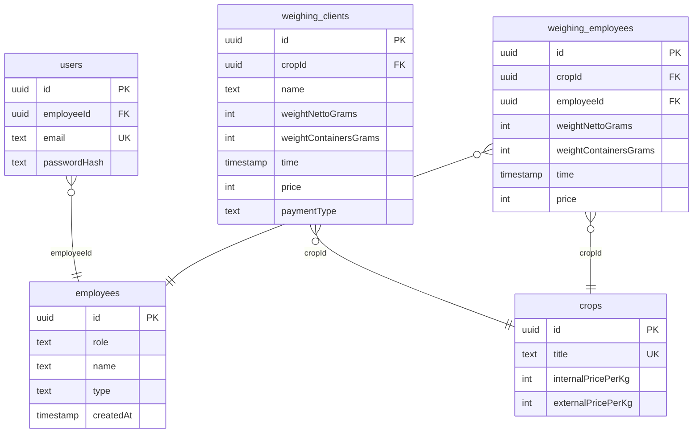

# Tables

| Name                                      | Columns | Comment |
| ----------------------------------------- | ------- | ------- |
| [crops](#crops)                           | 4       |         |
| [employees](#employees)                   | 5       |         |
| [users](#users)                           | 4       |         |
| [weighing_clients](#weighing_clients)     | 8       |         |
| [weighing_employees](#weighing_employees) | 7       |         |

---

## crops

### Columns

| Name               | Type    | Default             | Nullable | Children                                                                                       | Parents | Comment |
| ------------------ | ------- | ------------------- | -------- | ---------------------------------------------------------------------------------------------- | ------- | ------- |
| **id**             | uuid    | `gen_random_uuid()` | NO       | [weighing_clients.cropId](#weighing_clients), [weighing_employees.cropId](#weighing_employees) | -       | -       |
| title              | text    | -                   | NO       | -                                                                                              | -       | -       |
| internalPricePerKg | integer | -                   | NO       | -                                                                                              | -       | -       |
| externalPricePerKg | integer | -                   | NO       | -                                                                                              | -       | -       |

### Relations

| Parent                 | Child                                            | Type        |
| ---------------------- | ------------------------------------------------ | ----------- |
| **[crops.id](#crops)** | [weighing_clients.cropId](#weighing_clients)     | Many to One |
| **[crops.id](#crops)** | [weighing_employees.cropId](#weighing_employees) | Many to One |

---

## employees

### Columns

| Name      | Type      | Default             | Nullable | Children                                                                         | Parents | Comment |
| --------- | --------- | ------------------- | -------- | -------------------------------------------------------------------------------- | ------- | ------- |
| **id**    | uuid      | `gen_random_uuid()` | NO       | [users.employeeId](#users), [weighing_employees.employeeId](#weighing_employees) | -       | -       |
| role      | text      | -                   | NO       | -                                                                                | -       | -       |
| name      | text      | -                   | NO       | -                                                                                | -       | -       |
| type      | text      | -                   | NO       | -                                                                                | -       | -       |
| createdAt | timestamp | `now()`             | NO       | -                                                                                | -       | -       |

### Relations

| Parent                         | Child                                                | Type        |
| ------------------------------ | ---------------------------------------------------- | ----------- |
| **[employees.id](#employees)** | [users.employeeId](#users)                           | Many to One |
| **[employees.id](#employees)** | [weighing_employees.employeeId](#weighing_employees) | Many to One |

---

## users

### Columns

| Name         | Type | Default             | Nullable | Children | Parents                    | Comment |
| ------------ | ---- | ------------------- | -------- | -------- | -------------------------- | ------- |
| **id**       | uuid | `gen_random_uuid()` | NO       | -        | -                          | -       |
| employeeId   | uuid | -                   | NO       | -        | [employees.id](#employees) | -       |
| email        | text | -                   | NO       | -        | -                          | -       |
| passwordHash | text | -                   | NO       | -        | -                          | -       |

### Constraints

| Name                    | Type        | Definition                   |
| ----------------------- | ----------- | ---------------------------- |
| fk_employeeId_employees | FOREIGN KEY | (employeeId) → employees(id) |

### Relations

| Parent                     | Child                          | Type        |
| -------------------------- | ------------------------------ | ----------- |
| [employees.id](#employees) | **[users.employeeId](#users)** | Many to One |

---

## weighing_clients

### Columns

| Name                  | Type      | Default             | Nullable | Children | Parents            | Comment |
| --------------------- | --------- | ------------------- | -------- | -------- | ------------------ | ------- |
| **id**                | uuid      | `gen_random_uuid()` | NO       | -        | -                  | -       |
| cropId                | uuid      | -                   | NO       | -        | [crops.id](#crops) | -       |
| name                  | text      | -                   | NO       | -        | -                  | -       |
| weightNettoGrams      | integer   | -                   | NO       | -        | -                  | -       |
| weightContainersGrams | integer   | -                   | NO       | -        | -                  | -       |
| time                  | timestamp | `now()`             | NO       | -        | -                  | -       |
| price                 | integer   | -                   | NO       | -        | -                  | -       |
| paymentType           | text      | -                   | NO       | -        | -                  | -       |

### Constraints

| Name            | Type        | Definition           |
| --------------- | ----------- | -------------------- |
| fk_cropId_crops | FOREIGN KEY | (cropId) → crops(id) |

### Relations

| Parent             | Child                                            | Type        |
| ------------------ | ------------------------------------------------ | ----------- |
| [crops.id](#crops) | **[weighing_clients.cropId](#weighing_clients)** | Many to One |

---

## weighing_employees

### Columns

| Name                  | Type      | Default             | Nullable | Children | Parents                    | Comment |
| --------------------- | --------- | ------------------- | -------- | -------- | -------------------------- | ------- |
| **id**                | uuid      | `gen_random_uuid()` | NO       | -        | -                          | -       |
| cropId                | uuid      | -                   | NO       | -        | [crops.id](#crops)         | -       |
| employeeId            | uuid      | -                   | NO       | -        | [employees.id](#employees) | -       |
| weightNettoGrams      | integer   | -                   | NO       | -        | -                          | -       |
| weightContainersGrams | integer   | -                   | NO       | -        | -                          | -       |
| time                  | timestamp | `now()`             | NO       | -        | -                          | -       |
| price                 | integer   | -                   | NO       | -        | -                          | -       |

### Constraints

| Name                    | Type        | Definition                   |
| ----------------------- | ----------- | ---------------------------- |
| fk_cropId_crops         | FOREIGN KEY | (cropId) → crops(id)         |
| fk_employeeId_employees | FOREIGN KEY | (employeeId) → employees(id) |

### Relations

| Parent                     | Child                                                    | Type        |
| -------------------------- | -------------------------------------------------------- | ----------- |
| [crops.id](#crops)         | **[weighing_employees.cropId](#weighing_employees)**     | Many to One |
| [employees.id](#employees) | **[weighing_employees.employeeId](#weighing_employees)** | Many to One |

---

## ER Diagram

